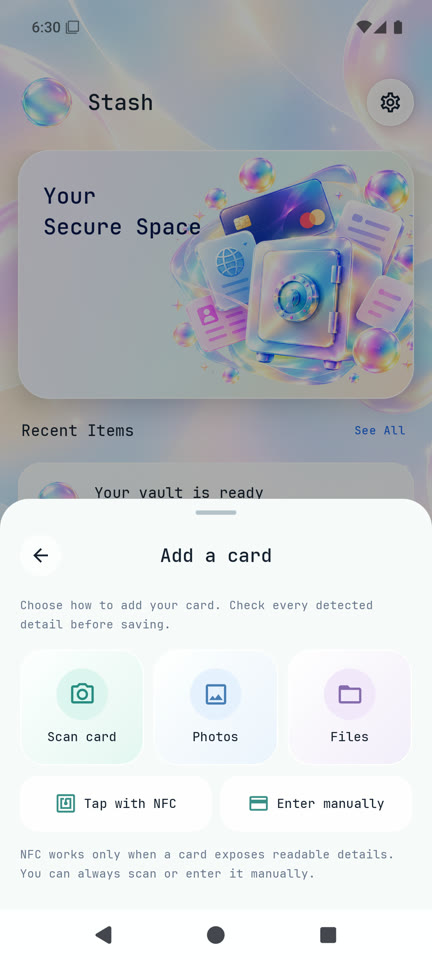
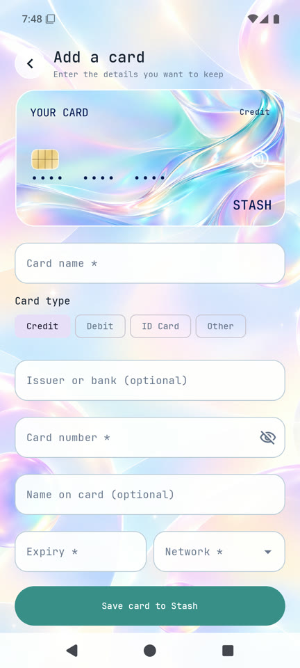
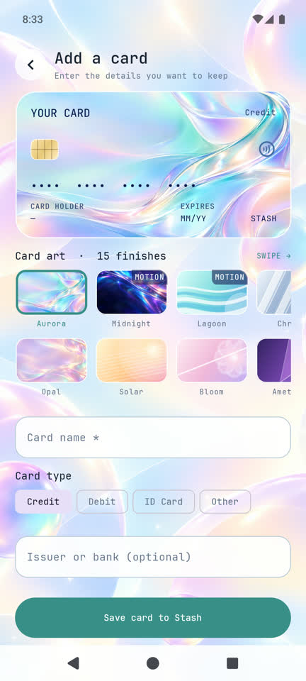
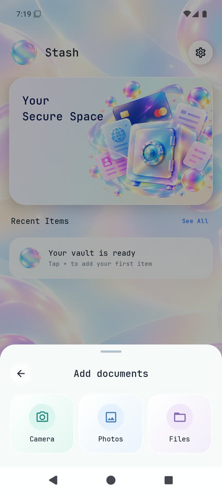
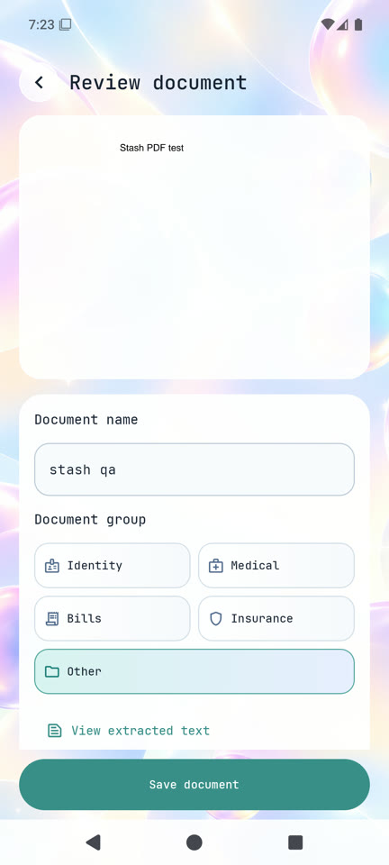
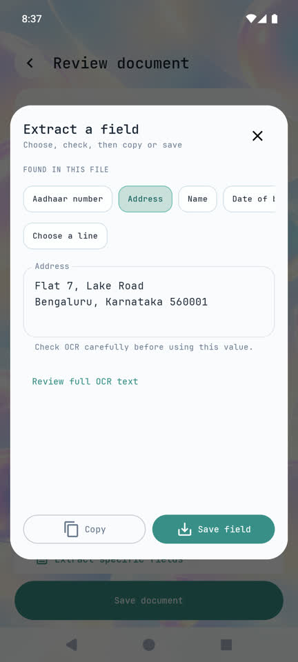
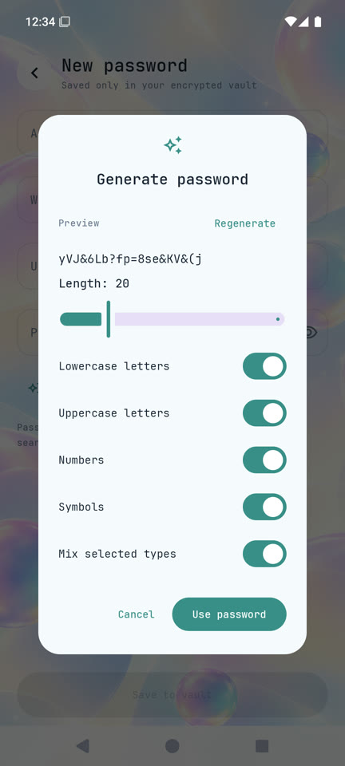

# Stash

Stash is a local Android vault for cards, documents, passwords, and notes, built with Kotlin and Jetpack Compose. The interface uses bundled Space Grotesk, aurora artwork, and translucent glass surfaces. Stash has no account, cloud service, or internet permission.

Card appearance offers 15 distinct designs in a single swipe row, 10 separate motion effects, and custom image, GIF, or video artwork. Card entry groups digits visually so typing and cursor placement stay stable. Image extraction now offers a review step for specific fields such as an Aadhaar number or address. The **Card number display** setting lets you mask both the number and CVC or keep the number visible while the CVC stays masked. Revealing a masked value requires device authentication.

## Screenshots

| Dashboard | Add to Stash |
| --- | --- |
|  |  |

| Card import | Card review |
| --- | --- |
|  |  |

| Card finishes |
| --- |
|  |

| Add documents | Review document |
| --- | --- |
|  |  |

| Review an extracted field |
| --- |
|  |

| Cards | Card detail |
| --- | --- |
|  |  |

| Password generator |
| --- |
|  |

| Documents | Profile | Settings |
| --- | --- | --- |
|  |  |  |

The card detail and document review screenshots use temporary files during emulator testing. The field extraction screenshot uses a fabricated document. The temporary vault items were deleted afterward; a new vault starts empty.

## Add and review

The center dock button first asks what you are adding:

- **Documents:** Scan one or more pages with CameraX, choose images from Android's photo picker, or select an image, PDF, or text file. Review the preview, title, document group, and locally extracted text before saving.
- **Cards:** Scan a card with the camera, import a card photo or file, tap a supported contactless card with NFC, or enter details manually. A card-specific review screen lets you check the type, number, name, expiry, issuer, and network before saving. The original imported image or file stays attached.
- **Password** and **Note:** Open short manual forms.

Image, PDF, and text imports are processed locally. Bundled ML Kit OCR works offline; PDF recognition is limited to the first 20 pages. Card OCR suggests plausible numbers and other visible details, but every field remains editable. The original selected file is kept as an encrypted attachment. Tapping a saved image or PDF opens a full-screen viewer with four floating glass tools: Edit, Scan, Share, and Delete. An info button at the top right shows an image preview, added date and time, size in MB, file type, and encrypted-storage details. Extraction offers detected fields and individual OCR lines for review and editing before copying or saving; it never copies the whole result automatically. OCR is a convenience and should be checked before use.

NFC is optional and needs an NFC-equipped device and a card that exposes usable fields through the supported contactless interface. Stash does not authenticate to banks or guarantee that every card can be read. The emulator has no NFC reader, so use camera or manual entry there. Nothing is saved from a tap until you confirm the review screen.

Manual credit and debit entry groups card numbers in fours, uses a numeric MM/YY expiry field, and offers a network picker with recognizable marks. Save explains missing or invalid fields. Standard payment cards require 16 digits; Amex uses its 15-digit format. An unverified checksum or expired card shows a warning but can still be saved. CVC is optional. Password entry includes a local random generator with length, character type, and mixing controls.

Card art can be chosen during review or changed when editing a saved card. Fifteen distinct designs include Aurora, Midnight, Opal, Coral Bloom, Lagoon, Flamingo, Chrome, Moon Garden, Arcade, Orbit Club, Sea Petals, Alpine, Night Fern, Petal Pop, and Prism. The collection mixes illustrations, graphic posters, landscape art, and liquid glass. Existing saved style identifiers remain compatible. Choose Still or one of 10 motion effects separately: Light sweep, Float, Glow, Tilt, Drift, Breathe, Ripple, Aurora flow, Stardust, or Orbit. The artwork icon beside Card art imports a custom image, GIF, or video. Card titles are derived from brand, issuer, and last four digits, so no separate card name is needed. Custom images and GIFs can be up to 16 megapixels; custom videos can be up to 30 seconds. All custom media must be under 8 MB and fit within the item attachment limit. GIFs and videos loop silently and stay encrypted with the card. Light or dark lettering can be selected for custom art. Partner brand and issuer bank have separate fields. Cards keep the same landscape proportions in lists, review, and details. Raw extracted OCR text is omitted from saved card reviews and details; scanning still suggests editable fields. The card collection uses masked numbers by default, while the detail screen shows the expiry, cardholder, network, and individual eye controls for saved number and CVC values. If no number or CVC was saved, its reveal control is omitted.

Settings includes a light/dark toggle, reduced motion, artwork autoplay, and local text recognition on import. Cards and Documents share aligned headers and larger tag filters. You can create and delete custom card tags and document groups; removing a tag keeps the items. Document file information shows its added date, size, file name, and type. Extraction remains available from the document preview.

The profile screen lets you change the display name and choose or remove a photo. Both stay in app-private local storage.

## Export

Settings offers readable JSON, PDF, Excel (`.xlsx`), and text exports, plus a separate encrypted backup. Readable exports contain item summaries and selected metadata. JSON can also contain the original attachments when **Include private fields** is enabled. PDF, Excel, and text list attachment names; use the item preview to send an original file. Readable exports are not encrypted, so choose a safe destination.

## Privacy and storage

- Records and imported attachments are encrypted with AES-GCM in app-private storage. Android Keystore holds the device-bound encryption key.
- Vault writes use atomic file replacement. Stash does not request broad photo or storage access; Android's pickers grant access only to items you choose.
- An optional CVC is encrypted in the device vault, masked in the UI, and omitted from readable exports. OCR redacts likely full card numbers, labeled security codes, and detected Aadhaar numbers before indexing.
- CVC is always masked and requires the device screen-lock credential to reveal. Card numbers are masked by default; Settings can show them without a reveal step. Clipboard clearing and app-lock preferences are available in Settings.
- Encrypted backup files can be exported and restored locally, but the key is device-bound: a backup is restorable only on the device that created it.
- Sharing an original attachment uses a temporary app-private cache file, which Stash removes after ten minutes or on next launch.
- The vault starts empty. There are no demo records, sample cards, or seeded passwords.

## Current scope

- NFC import is best effort for readable ISO-DEP payment cards; it may return no details for some cards. Stash does not connect to a bank.
- The scanner captures pages but does not include automatic edge detection, perspective correction, or crop/rotate editing.
- OCR quality depends on the photo and supported text. For PDFs, only the first 20 pages are indexed; the original PDF remains attached.
- Data is local to this installation. There is no cloud sync or account recovery, and device-bound backups cannot be moved to another device.

## Build and test

The installable APK is available from [the latest GitHub release](https://github.com/YumiNoona/Stash/releases/latest). Release APKs are currently debug signed; an official signing key has not been configured.

Requirements: JDK 17 and Android SDK Platform 36. From PowerShell at the repository root:

```powershell
.\gradlew.bat testDebugUnitTest
.\gradlew.bat :app:assembleDebug
```

Install the debug build on a connected Android device or emulator:

```powershell
adb install -r app/build/outputs/apk/debug/app-debug.apk
```

The APK is written to `app/build/outputs/apk/debug/app-debug.apk`. Gradle may need network access to download build dependencies; the installed app itself runs locally and does not use the network.

## Project structure

- `app/src/main/java/com/lockr/app/` — Compose screens, navigation, import/OCR, encrypted storage, and settings.
- `app/src/test/` — JVM unit tests for OCR privacy, vault search, card recognition, and NFC data parsing.
- `docs/screenshots/` — emulator captures embedded above.
- `docs/licenses/` — the JetBrains Mono font license.

Space Grotesk is bundled from the font author's official repository, with its SIL
Open Font License in `docs/licenses/Space-Grotesk-OFL.txt`. No font download is
needed when running the app. The light/dark toggle is the single theme control in
Settings. Dark mode uses soft charcoal, lavender, and teal lighting. Profile
photos retain a visible gradient frame in both modes. The edit-card artwork and
motion headings are hidden while their selection controls remain available.

Version 1.5 refreshes Coral Bloom, Sea Petals, Night Fern, and Petal Pop with clean
vector botanical artwork; Moon Garden remains available. The art picker displays
full card compositions with a segmented metallic chip. Dark Add to Stash tiles
use distinct teal and lilac glass colors with bright icons. Document information
has no group editor; organization stays in the collection and import flow. The
full-screen viewer supports pinch zoom, bounded pan, and multi-page PDF paging.
Editable botanical masters are in `docs/artwork/`.
