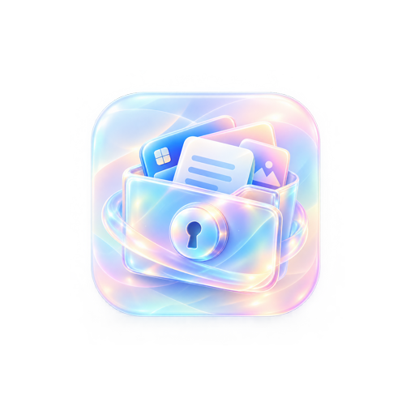
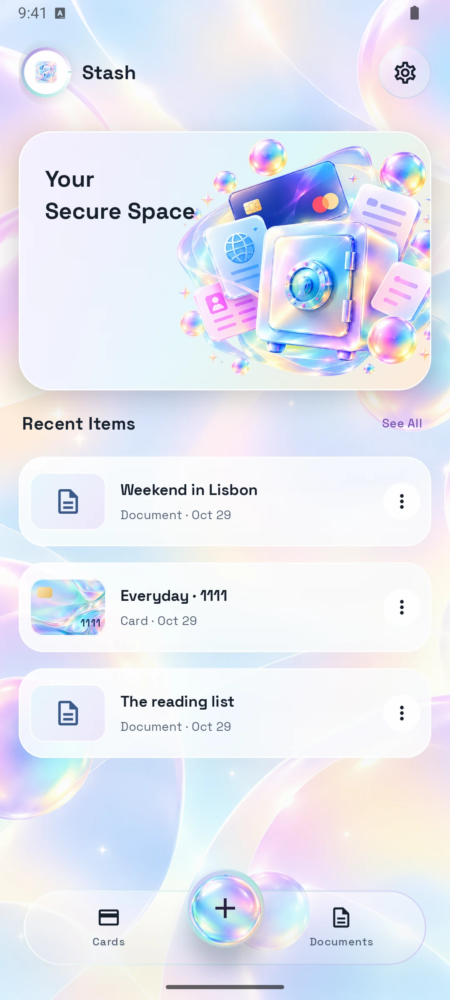
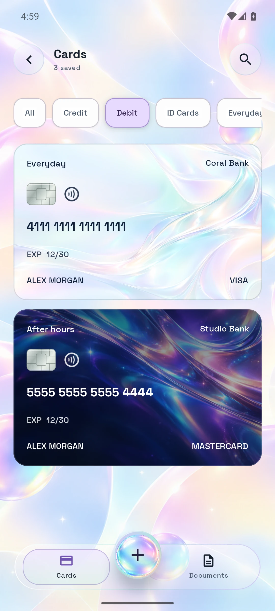
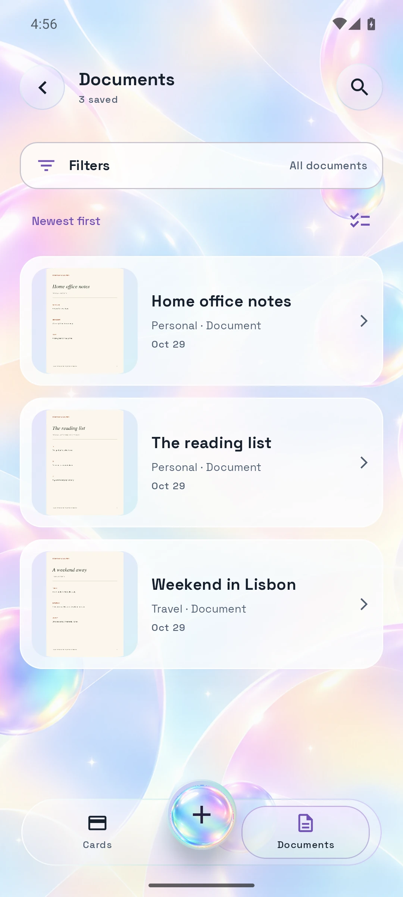
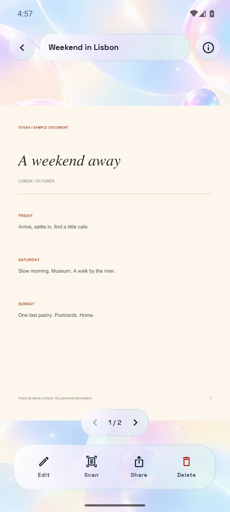
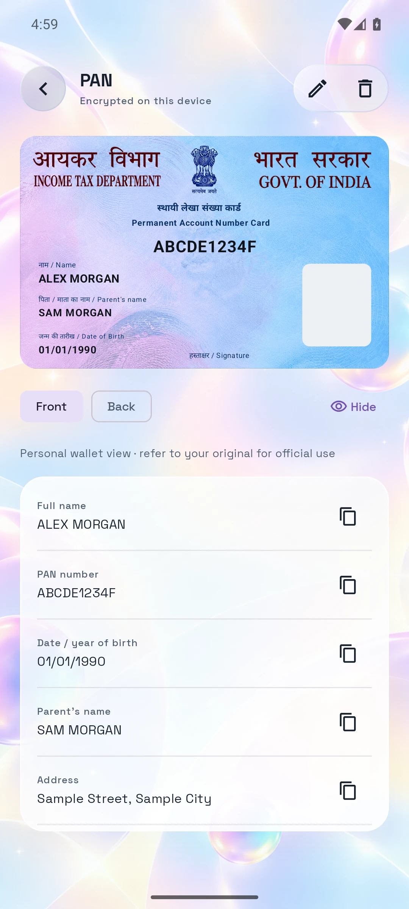
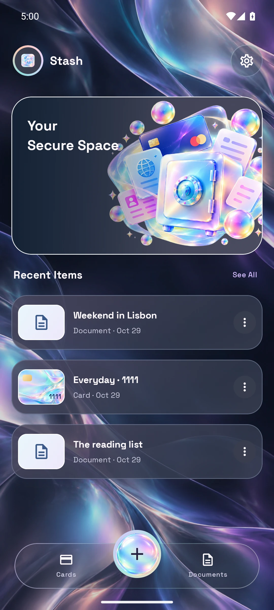

<div align="center">
  
  <h1>Stash</h1>
  <p><strong>A little space for everything important.</strong></p>
  <p>Your cards, documents, IDs, passwords and notes — together in a beautiful, offline Android vault.</p>
  <p>
    
    
    
    
    
  </p>
  <p><a href="https://github.com/YumiNoona/Stash/releases/download/v1.0.0/Stash-v1.0.0.apk"><strong>Download Android APK</strong></a> · <a href="web/">Website source</a> · <a href="https://github.com/YumiNoona/Stash/issues">Report an issue</a></p>
</div>

## Keep life together

Stash puts your everyday essentials in one place, with aurora artwork, floating glass controls, Space Grotesk typography and soft light and dark themes. There is no account, subscription, cloud sync or internet permission. A new vault starts empty.

- **Cards that feel like yours.** Save bank and partner details, choose original card artwork and subtle motion, or use a custom image, GIF or silent video. Keep readable landscape previews and reveal private details when needed.
- **Documents, without the pile.** Scan or import images, PDFs and text. Keep multiple pages in one document, organize folders and tags, and select several items to move, download or delete.
- **Identity details close at hand.** Store Aadhaar, PAN, voter ID and driving licence details in familiar front/back layouts, with your own photo and original scans alongside. These are personal wallet views; their website QR contains no identity data.
- **Useful little extras.** Save notes and passwords, generate passwords locally, search your vault, extract text on the device, and add wallet or document home-screen widgets.
- **Your information stays local.** AES-GCM encrypted records and attachments, Android Keystore, device-credential protection, clipboard clearing, explicit sharing and local exports.

## A look inside

Six captures from the production app, using **fictional sample data**. No sample records are included in the APK.

<table>
  <tr><th align="center">Your space</th><th align="center">Your cards</th><th align="center">Your documents</th></tr>
  <tr>
    <td></td>
    <td></td>
    <td></td>
  </tr>
  <tr><th align="center">Room for every page</th><th align="center">Identity details</th><th align="center">A softer dark mode</th></tr>
  <tr>
    <td></td>
    <td></td>
    <td></td>
  </tr>
</table>

## Install

Download [Stash v1.0.0](https://github.com/YumiNoona/Stash/releases/tag/v1.0.0), open the APK on Android 8.0 or newer, and allow installation from your browser or file manager when prompted. The release includes a SHA-256 checksum. This is a production-signed, non-debuggable, optimized build.

**Coming from an older test APK?** The production signing key is different from the former debug key, so Android cannot update those installations directly. Export and verify your information before changing installations. Uninstalling deletes the local vault and its device-bound encryption key; an encrypted backup cannot recover that deleted key. See [installation and signing](docs/building.md).

## Privacy, honestly

Stash encrypts its vault and attachments in app-private storage. It has no analytics, server or runtime network access. Sharing and readable exports happen only when you choose them; readable exports are **not encrypted**. Encrypted backups currently restore only on the installation/device that retains the original key. There is no cloud recovery.

Text recognition uses bundled Latin OCR and needs review. NFC import is best effort and requires compatible hardware. Identity templates are personal records, not issued or verified digital IDs. See [privacy and current limits](docs/privacy.md).

## Build

Use JDK 17+ and Android SDK 36. The Gradle wrapper is included.

```powershell
.\gradlew.bat testDebugUnitTest :app:lintDebug :app:assembleDebug
# Configure your own private signing key first:
.\gradlew.bat :app:assembleRelease :app:lintRelease
```

See [the build guide](docs/building.md) for production signing. Keys and passwords must stay outside Git.

The website needs Node.js 20+ and no dependencies:

```sh
cd web
npm run dev
npm run check
npm run build
```

## Project layout

```text
Stash/
├── app/                 Android app, resources and JVM tests
├── docs/                Build/privacy guides, artwork sources and font license
├── gradle/              Gradle wrapper
├── web/                 Complete static product website and six app screenshots
├── build.gradle.kts     Shared Android build configuration
└── settings.gradle.kts  Project modules
```

Space Grotesk is bundled locally under its [SIL Open Font License](docs/licenses/Space-Grotesk-OFL.txt). Artwork provenance and identity layout references live in `docs/`. Build caches, APKs, signing material and generated website output are excluded from Git.
