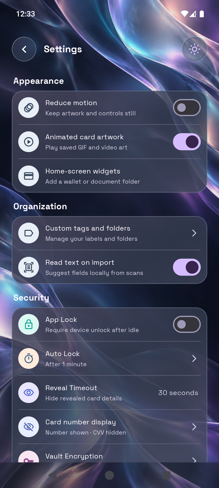
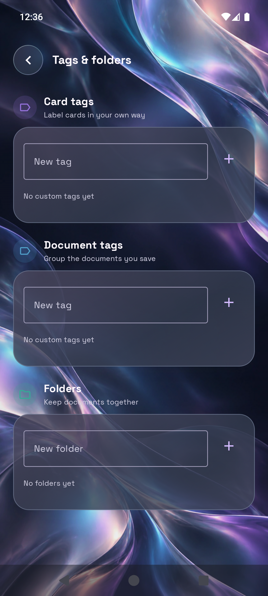

# Stash

Stash is a local Android vault for cards, documents, passwords, and notes, built with Kotlin and Jetpack Compose. The interface uses bundled Space Grotesk, aurora artwork, and translucent glass surfaces. Stash has no account, cloud service, or internet permission.

Card appearance offers 15 distinct designs in a single swipe row, 10 separate motion effects, and custom image, GIF, or video artwork. Card entry groups digits visually so typing and cursor placement stay stable. Image extraction offers a review step for specific fields such as an Aadhaar number or address. Card numbers and expiry dates display by default; Settings can hide card numbers. CVV stays hidden until you tap its eye control, and cards without one omit the CVV line.

## Screenshots

| Dashboard | Add to Stash |
| --- | --- |
|  |  |

| Card import | Card review |
| --- | --- |
|  |  |

| Card finishes |
| --- |
|  |

| Add documents | Review document |
| --- | --- |
|  |  |

| Review an extracted field |
| --- |
|  |

| Cards | Card detail |
| --- | --- |
|  |  |

| Password generator |
| --- |
|  |

| Documents | Profile | Settings |
| --- | --- | --- |
|  |  |  |

| Tags and folders |
| --- |
|  |

The card detail and document review screenshots use temporary files during emulator testing. The field extraction screenshot uses a fabricated document. The temporary vault items were deleted afterward; a new vault starts empty.

## Add and review

The center dock button first asks what you are adding:

- **Documents:** Scan one or more pages with CameraX, choose images from Android's photo picker, or select an image, PDF, or text file. Review the pages, title and document group before saving.
- **Cards:** Scan a card with the camera, import a card photo or file, tap a supported contactless card with NFC, or enter details manually. A card-specific review screen lets you check the type, number, name, expiry, issuer, and network before saving. The original imported image or file stays attached.
- **Password** and **Note:** Open short manual forms.

Image, PDF, and text imports are processed locally. Bundled ML Kit OCR works offline; PDF recognition is limited to the first 20 pages. Card OCR suggests plausible numbers and other visible details, but every field remains editable. The original selected file is kept as an encrypted attachment. Tapping a saved image or PDF opens a full-screen viewer with four floating glass tools: Edit, Scan, Share, and Delete. Edit opens a name and page organizer sheet; Share previews the actual document before opening Android's chooser; Delete requires confirmation. An info button at the top right shows added date and time, size in MB, file type, and encrypted-storage details without another image preview. Extraction offers detected fields and individual OCR lines for review and editing before copying or saving; it never copies the whole result automatically. OCR is a convenience and should be checked before use.

NFC is optional and needs an NFC-equipped device and a card that exposes usable fields through the supported contactless interface. Stash does not authenticate to banks or guarantee that every card can be read. The emulator has no NFC reader, so use camera or manual entry there. Nothing is saved from a tap until you confirm the review screen.

Manual credit and debit entry groups card numbers in fours, uses a numeric MM/YY expiry field, and offers a network picker with recognizable marks. Save explains missing or invalid fields. Standard payment cards require 16 digits; Amex uses its 15-digit format. An unverified checksum or expired card shows a warning but can still be saved. CVC is optional. Password entry includes a local random generator with length, character type, and mixing controls.

After entering card details, Save opens the art and motion picker; Skip uses the basic design. Artwork can also be changed when editing a saved card. The artwork catalog includes Aurora, Midnight, Lagoon, Flamingo, Chrome, Moon Garden, Arcade, Orbit Club, Alpine, Prism, Folded Light, Chrome Playground, Lunar Dunes and Paper Jazz. The collection mixes illustrations, graphic posters, landscape art, and liquid glass. Existing saved style identifiers remain compatible. Choose Still or one of 10 motion effects separately: Light sweep, Float, Glow, Tilt, Drift, Breathe, Ripple, Aurora flow, Stardust, or Orbit. The artwork icon beside Card art imports a custom image, GIF, or video. Card titles are derived from brand, issuer, and last four digits, so no separate card name is needed. Custom images and GIFs can be up to 16 megapixels; custom videos can be up to 30 seconds. All custom media must be under 8 MB and fit within the item attachment limit. GIFs and videos loop silently and stay encrypted with the card. Light or dark lettering can be selected for custom art. Partner brand and issuer bank have separate fields. Cards keep the same landscape proportions in lists, review, and details. Raw extracted OCR text is omitted from saved card reviews and details; scanning still suggests editable fields. The card collection shows numbers and expiry dates by default, with an eye beside an available CVV. A list reveal automatically hides again after 30 seconds. In card detail, private reveal uses the device screen lock. If no CVC was saved, its line and reveal control are omitted.

Settings includes a light/dark toggle, reduced motion, artwork autoplay, and local text recognition on import. Cards and Documents share aligned, frameless headings and larger tag filters. **Settings → Custom tags and folders** opens a dedicated screen to create or delete card tags and document groups, and to create, rename, or remove document folders. Removing a tag or folder keeps its items. Document file information shows its added date, size, file name, and type. Extraction remains available from the document preview. Vault loading and profile photo decoding run off the UI thread; the startup placeholder is removed.

The profile screen lets you change the display name and choose or remove a photo. Both stay in app-private local storage.

## Export

Settings offers readable JSON, PDF, Excel (`.xlsx`), and text exports, plus a separate encrypted backup. Readable exports contain item summaries and selected metadata. JSON can also contain the original attachments when **Include private fields** is enabled. PDF, Excel, and text list attachment names; use the item preview to send an original file. Readable exports are not encrypted, so choose a safe destination.

## Privacy and storage

- Records and imported attachments are encrypted with AES-GCM in app-private storage. Android Keystore holds the device-bound encryption key.
- Vault writes use atomic file replacement. Stash does not request broad photo or storage access; Android's pickers grant access only to items you choose.
- An optional CVC is encrypted in the device vault, masked in the UI, and omitted from readable exports. OCR redacts likely full card numbers, labeled security codes, and detected Aadhaar numbers before indexing.
- CVC starts masked and its collection reveal expires after 30 seconds; revealing in card detail requires the device screen-lock credential. Card numbers display by default and can be masked in Settings. Clipboard clearing and app-lock preferences are available in Settings.
- Encrypted backup files can be exported and restored locally, but the key is device-bound: a backup is restorable only on the device that created it.
- Sharing uses temporary app-private cache files, removed after ten minutes or on next launch. Document-wide redaction creates a flattened copy; saved originals remain unchanged.
- The vault starts empty. There are no demo records, sample cards, or seeded passwords.

## Current scope

- NFC import is best effort for readable ISO-DEP payment cards; it may return no details for some cards. Stash does not connect to a bank.
- The scanner supports manual four-corner perspective correction, page rotation, reordering, removal, and adding pages to both new and saved documents. Automatic edge detection is not included.
- OCR quality depends on the photo and supported text. For PDFs, only the first 20 pages are indexed; the original PDF remains attached.
- Data is local to this installation. There is no cloud sync or account recovery, and device-bound backups cannot be moved to another device.

## Build and test

The installable APK is available from [the latest GitHub release](https://github.com/YumiNoona/Stash/releases/latest). Release APKs are currently debug signed; an official signing key has not been configured.

Requirements: JDK 17 and Android SDK Platform 36. From PowerShell at the repository root:

```powershell
.\gradlew.bat testDebugUnitTest
.\gradlew.bat :app:assembleDebug
```

Install the debug build on a connected Android device or emulator:

```powershell
adb install -r app/build/outputs/apk/debug/app-debug.apk
```

The APK is written to `app/build/outputs/apk/debug/app-debug.apk`. Gradle may need network access to download build dependencies; the installed app itself runs locally and does not use the network.

## Project structure

- `app/src/main/java/com/lockr/app/` — Compose screens, navigation, import/OCR, encrypted storage, and settings.
- `app/src/test/` — JVM unit tests for OCR privacy, vault search, card recognition, and NFC data parsing.
- `docs/screenshots/` — emulator captures embedded above.
- `docs/licenses/` — bundled font licenses, including Space Grotesk.

Space Grotesk is bundled from the font author's official repository, with its SIL
Open Font License in `docs/licenses/Space-Grotesk-OFL.txt`. No font download is
needed when running the app. The light/dark toggle is the single theme control in
Settings. Dark mode uses soft charcoal, lavender, and teal lighting. Profile
photos retain a visible gradient frame in both modes. The edit-card artwork and
motion headings are hidden while their selection controls remain available.

The current card art catalog keeps Aurora, Midnight, Moon Garden and the approved
illustrations alongside Folded Light, Chrome Playground, Lunar Dunes and Paper
Jazz. Superseded botanical assets are no longer offered. Basic remains available
through Skip and for existing cards, not in the artwork carousel. Dark mode has
its own full-screen artwork. Backgrounds can be chosen independently for light
and dark mode; custom photos are bounded, oriented and installed atomically.

Version 1.7 adds a dedicated Tags & folders screen, streamlined headings, a shorter Home recent list on phones, card number visibility controls, and a document share preview with working Android chooser thumbnails. It also moves vault startup cache cleanup and profile-photo decoding off the first UI frame.

Version 1.7.1 fixes page-corner dragging, blocks saving while pages are being
imported, applies the same 20-file/24 MB limits to camera and file imports,
centralizes folder validation, and handles download failures. Home card copies
are masked by default; including a full number requires explicit opt-in and
device authentication. Readable vault exports with private fields also require
a device credential. Verification codes are never exported as metadata.

Saved-document editing keeps an isolated draft, offers one-step undo, and applies
add/scan/correct/reorder/rotate/remove changes only on Save pages. Redaction keeps
all image and PDF pages together (up to 100 pages), exports a flattened PDF for a
multi-page document, and does not silently drop unreadable pages. Device-bound
backup portability and separate encrypted attachment storage remain future work.


## Offline identity cards

Add -> Cards -> Identity card creates a dedicated Aadhaar, PAN, voter ID, driving
licence or Other ID. Photo/file card imports can suggest a supported type using
bundled OCR. Check every suggestion. Document review and a saved document's Edit
menu can also create an identity card while keeping the original document.

Each type has its own front/back layout, colours, labels and relevant fields,
including local-language names, dates, address and licence validity/classes.
Add image or PDF originals, then crop the portrait, original QR, signature and
issuer logo into their places. PDF cropping includes a page selector. Unavailable
images stay empty; Stash does not invent photos, issuer security marks or QR data.

Identity numbers stay masked in the collection. Device credentials unlock private
fields, copying, original scans, QR display and editing. Details and all cropped
images are encrypted in the local vault and work without internet. QR images are
preserved from the source; digital signatures are not verified. These are personal
wallet views, with the original available separately. OCR currently reads Latin
text; local-language names remain manually editable.

See [identity-card design references](docs/identity-card-design.md) for the issuer
sources, layout choices and storage behaviour.
