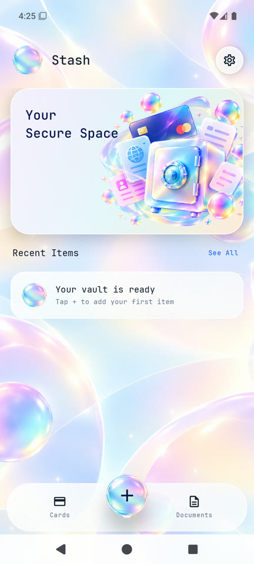
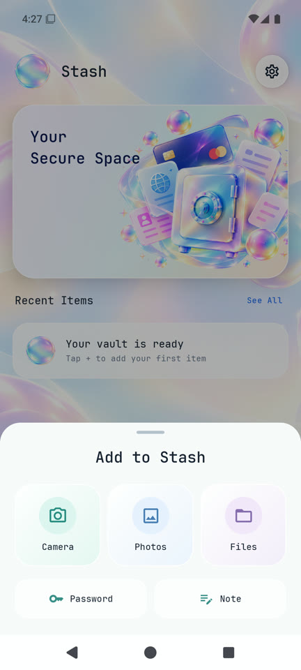
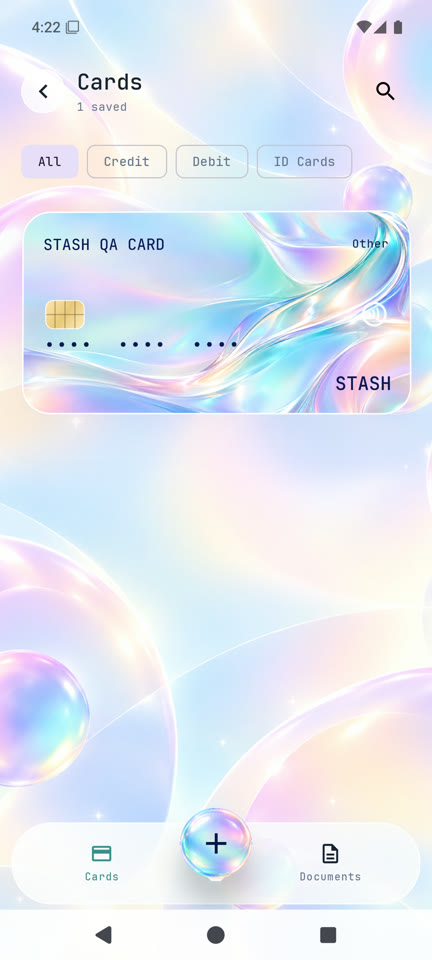
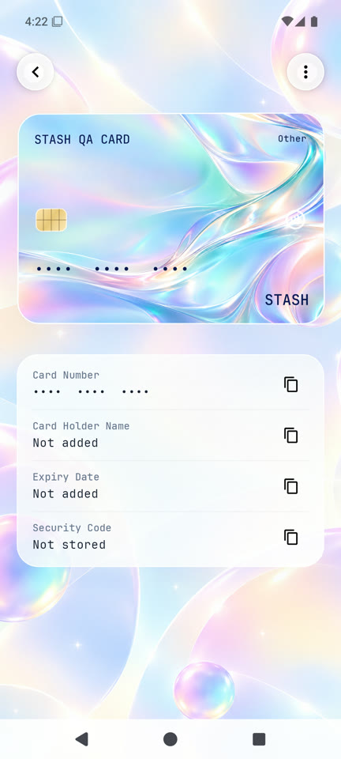
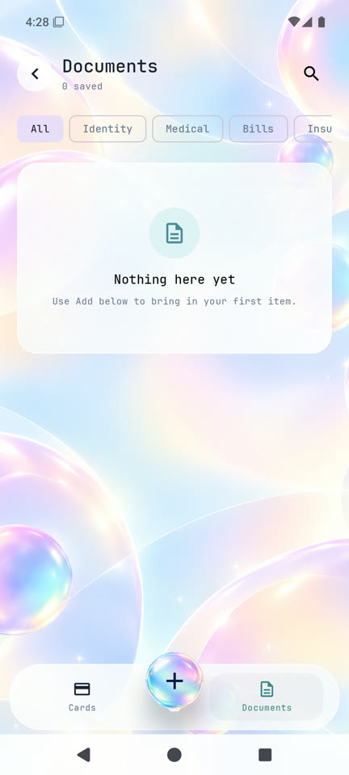
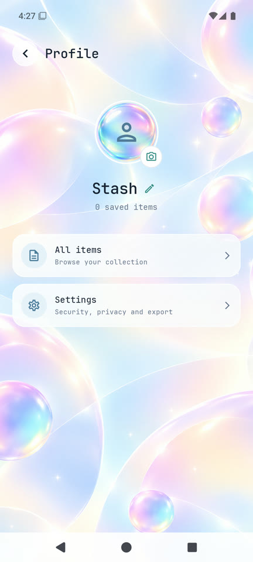
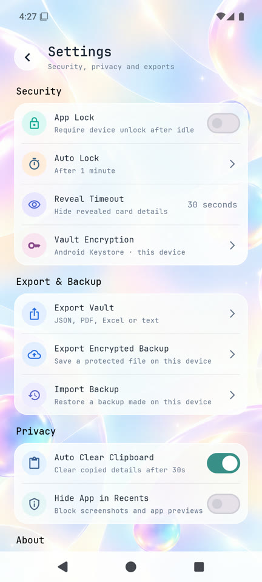

# Stash

Stash is a local Android vault for cards, documents, passwords, and notes, built with Kotlin and Jetpack Compose. The interface uses JetBrains Mono, aurora artwork, and glass surfaces. Stash has no account, cloud service, or internet permission.

## Screenshots

| Dashboard | Add sources |
| --- | --- |
|  |  |

| Cards | Card detail |
| --- | --- |
|  |  |

| Documents | Profile | Settings |
| --- | --- | --- |
|  |  |  |

The card screenshots show a temporary file imported during emulator testing. It was deleted afterward; a new vault starts empty.

## Add and review

The center dock button opens a compact source picker:

- **Scan with camera** captures one or more pages using CameraX.
- **Choose photos** opens Android's photo picker.
- **Choose files** opens the Android file picker for PDFs, images, and text files.
- **Password** and **Note** open short manual forms. Imported items can be reviewed, reclassified, and renamed before saving.

Image, PDF, and text imports are processed locally. Bundled ML Kit OCR works offline; PDF recognition is limited to the first 20 pages. The review step suggests a category, document group or card type, title, and (when a card number is detected) its last four digits. The original selected file is kept as an encrypted attachment. Tapping a saved image or PDF opens a preview with rename, extract text, send, details, and delete actions. OCR is a convenience and should be checked before saving.

The profile screen lets you change the display name and choose or remove a photo. Both stay in app-private local storage.

## Export

Settings offers readable JSON, PDF, Excel (`.xlsx`), and text exports, plus a separate encrypted backup. Readable exports contain item summaries and selected metadata. JSON can also contain the original attachments when **Include private fields** is enabled. PDF, Excel, and text list attachment names; use the item preview to send an original file. Readable exports are not encrypted, so choose a safe destination.

## Privacy and storage

- Records and imported attachments are encrypted with AES-GCM in app-private storage. Android Keystore holds the device-bound encryption key.
- Vault writes use atomic file replacement. Stash does not request broad photo or storage access; Android's pickers grant access only to items you choose.
- Stash does not store a card CVV/CVC/security code. OCR redacts likely full card numbers and labeled security codes before indexing.
- Sensitive values are masked and require the device screen-lock credential to reveal. Clipboard clearing and app-lock preferences are available in Settings.
- Encrypted backup files can be exported and restored locally, but the key is device-bound: a backup is restorable only on the device that created it.
- Sharing an original attachment uses a temporary app-private cache file, which Stash removes after ten minutes or on next launch.
- The vault starts empty. There are no demo records, sample cards, or seeded passwords.

## Current scope

- Stash does not connect to a bank or read cards over NFC. NFC is not part of this release.
- The scanner captures pages but does not include automatic edge detection, perspective correction, or crop/rotate editing.
- OCR quality depends on the photo and supported text. For PDFs, only the first 20 pages are indexed; the original PDF remains attached.
- Data is local to this installation. There is no cloud sync or account recovery, and device-bound backups cannot be moved to another device.

## Build and test

Requirements: JDK 17 and Android SDK Platform 36. From PowerShell at the repository root:

```powershell
.\gradlew.bat testDebugUnitTest
.\gradlew.bat :app:assembleDebug
```

Install the debug build on a connected Android device or emulator:

```powershell
adb install -r app/build/outputs/apk/debug/app-debug.apk
```

The APK is written to `app/build/outputs/apk/debug/app-debug.apk`. Gradle may need network access to download build dependencies; the installed app itself runs locally and does not use the network.

## Project structure

- `app/src/main/java/com/lockr/app/` — Compose screens, navigation, import/OCR, encrypted storage, and settings.
- `app/src/test/` — JVM unit tests for OCR privacy and vault search behavior.
- `docs/screenshots/` — emulator captures embedded above.
- `docs/licenses/` — the JetBrains Mono font license.
